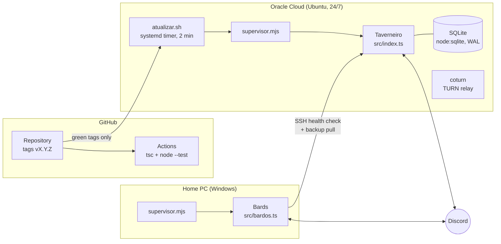

# Taverneiro: the Taverna Discord bot

[Português](README.md) | **English**

Taverneiro is an all-in-one Discord bot built for a Brazilian gaming community (the "Taverna dos Malucos" server), so the commands and messages are in Portuguese. It replaces the usual stack of ten separate bots with a single codebase: auto-created voice channels, music, D&D 3.5 and Daggerheart tools, looking-for-group pings, an XP and coin economy with mini-games, onboarding and moderation. A single `/setup` command builds the whole server structure and can be re-run safely. The project is also an exercise in running a small production service end to end: typed code, tests in CI, versioned releases, a cloud deployment that only ships green tags, and two processes that watch each other.

## Technical highlights

- **TypeScript with no build step.** Node 24 runs the `.ts` files directly (type stripping); `tsc` only type-checks, with `strict`, `erasableSyntaxOnly` and `verbatimModuleSyntax`. → [`tsconfig.json`](tsconfig.json), [`package.json`](package.json)
- **Domain logic separated from Discord.** `src/lib/` holds pure rules (dice parser, economy, casino odds, duels, radio queue, weekly stats...) with `node:test` suites next to them; `src/recursos/` holds the Discord handlers that call into them. → [`src/lib/dados.ts`](src/lib/dados.ts) and [`dados.test.ts`](src/lib/dados.test.ts), [`src/lib/cassino.ts`](src/lib/cassino.ts) and [`jogos.test.ts`](src/lib/jogos.test.ts)
- **CI gate on every push.** GitHub Actions installs from scratch with `npm ci`, then runs the type check and the test suite. → [`.github/workflows/verificar.yml`](.github/workflows/verificar.yml)
- **Release and deploy pipeline.** `npm run lancar` bumps the version, writes the changelog, commits, tags and pushes. On the server, a systemd timer checks every 2 minutes and deploys only the latest `vX.Y.Z` tag, and only after its GitHub check runs have passed; loose commits on `main` never reach production. → [`scripts/lancar.mjs`](scripts/lancar.mjs), [`scripts/nuvem/atualizar.sh`](scripts/nuvem/atualizar.sh), [`scripts/nuvem/instalar.sh`](scripts/nuvem/instalar.sh)
- **Process supervisor.** Restarts the bot on file changes or crashes (with backoff), rotates logs, prevents duplicate instances with a PID lock, postpones restarts while the bot is busy (for example, playing music), and never starts the bot while a deploy is still running `npm ci`. → [`scripts/supervisor.mjs`](scripts/supervisor.mjs)
- **Split deployment for music.** YouTube blocks many cloud IP ranges, so the main bot runs on Oracle Cloud while separate "bard" bots, which only play music, run on a home PC. Since Discord allows one voice connection per bot account per server, each bard is one more channel playing at the same time; a new request goes to the first free bard. → [`src/bardos.ts`](src/bardos.ts), [`src/recursos/musica.ts`](src/recursos/musica.ts)
- **Two-way health checks and off-site backups.** The cloud bot alerts the owner when every bard has been offline for more than 10 minutes; the home PC checks the cloud service over SSH and pulls the daily database backup (keeping the last 14). → [`src/recursos/vigiaBardos.ts`](src/recursos/vigiaBardos.ts), [`src/recursos/vigiaNuvem.ts`](src/recursos/vigiaNuvem.ts)
- **SQLite done carefully.** Built-in `node:sqlite` in WAL mode, a prepared-statement cache, and numbered migrations tracked with `PRAGMA user_version`. → [`src/db.ts`](src/db.ts)
- **Image rendering off the main thread.** Profile cards, duel scenes and quiz images are drawn as SVG and rasterized with resvg in a pool of two worker threads, so rendering never stalls commands or audio. → [`src/lib/renderizar.ts`](src/lib/renderizar.ts), [`src/lib/renderizarWorker.ts`](src/lib/renderizarWorker.ts)
- **Tested game math.** The slot machine's expected return (house edge around 7%) is computed and asserted in tests; daily betting limits are configurable per server. → [`src/lib/cassino.ts`](src/lib/cassino.ts), [`src/lib/jogos.test.ts`](src/lib/jogos.test.ts)
- **Browser-based screen sharing.** `/tela` opens a room on a companion WebRTC page hosted on GitHub Pages; a coturn TURN server on the same cloud machine relays the stream when peers sit behind CGNAT. → [`src/lib/tela.ts`](src/lib/tela.ts), [`scripts/nuvem/turn.sh`](scripts/nuvem/turn.sh)
- **Least-privilege intents and per-role commands.** Privileged intents are requested only where needed (Message Content is optional), and an OAuth2 flow applies per-role command permissions so each command only shows up for the roles that use it. → [`src/index.ts`](src/index.ts), [`src/recursos/permissoesComandos.ts`](src/recursos/permissoesComandos.ts)

## Features at a glance

Around 60 slash commands, grouped roughly as:

- **Server and onboarding:** idempotent `/setup` (roles, categories, channels, rules, emoji upload, optional full reset with backup), a verification form that grants roles, welcome messages, community-run subgroups with staff approval.
- **Voice and music:** join-to-create voice channels named after the game you are playing, YouTube/Spotify/SoundCloud playback, an endless `/radio` that follows YouTube Music recommendations without repeats, ambient tracks for RPG tables.
- **Tabletop RPG:** dice notation (`4d6kh3`, `1d20+5`), D&D 3.5 character sheets and checks, Daggerheart duality dice with Hope and Fear tracking, NPC, tavern and loot generators, session scheduling as Discord events.
- **Community and games:** XP and coins for activity, level roles, a shop, casino, duels, achievements, a daily Portuguese Wordle, League of Legends quiz and rank lookup (Riot API), free game alerts (Epic, Steam, GOG), a starboard and a weekly recap.
- **Moderation and operations:** full audit log in a staff channel, `/logs` queries, bulk delete, timeouts, `/status` and downtime alerts.

The full command list (in Portuguese) lives in the [Portuguese README](README.md) and on the static page in [`site/`](site/).

## Architecture



```
src/
  index.ts        main bot: client setup, intents, command and button routing
  bardos.ts       music-only bots (run on the home PC)
  db.ts           SQLite connection, statement cache, migrations
  config.ts       server layout: roles, channels, games
  lib/            pure domain logic + *.test.ts
  recursos/       Discord features (commands, buttons, events)
scripts/          supervisor, release script, Windows service, cloud install/update/TURN
site/             static command reference page
```

## Running and testing

Requirements: Node.js 24+ and a Discord application with the bot token, the **Server Members** and **Presence** intents enabled, and the bot role placed at the top of the server's role list.

```bash
npm install
cp .env.example .env    # set DISCORD_TOKEN (music bards use TOKEN_MUSICA_2, TOKEN_MUSICA_3...)
npm start               # main bot; then run /setup on the server
npm run dev             # restart on save
npm test                # node --test over src/lib/*.test.ts (83 tests)
npm run typecheck       # tsc, no emit
```

Optional settings go in the same `.env`: `RIOT_API_KEY` for League of Legends lookups, `CLIENT_SECRET` for per-role command permissions and `NUVEM_SSH` for the cloud watchdog. For running in the background on Windows, cloud deployment and troubleshooting, see the [Portuguese README](README.md).

## Status

In production on the community's server: the main bot runs 24/7 in the cloud and the bards run on the home PC. Current version: v1.6.0 (see the [changelog](CHANGELOG.md), written for server members in Portuguese).
